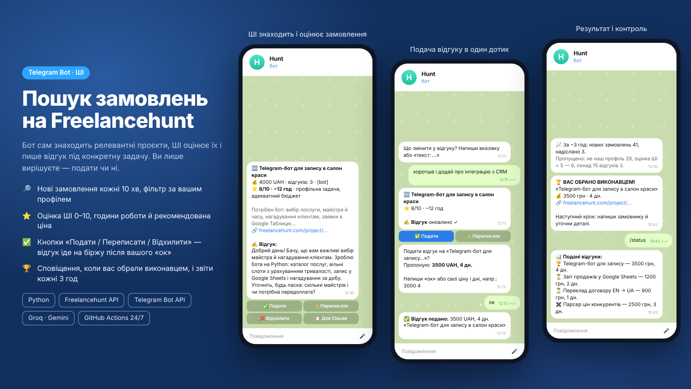

# Freelancehunt-бот



Шукає нові релевантні замовлення (боти, таблиці, ШІ-автоматизація, мобільні застосунки, веб-розробка, інтеграції й API, DevOps, дизайн, переклади). ШІ оцінює кожне і пише відгук під конкретне завдання. Усе приходить у Telegram з кнопками:

- **✅ Подати** — бот пропонує ціну і строк; відповідаєш «ок» або «3000 4». Freelancehunt вимкнув подачу відгуків через API (HTTP 410), тому бот надсилає посилання, ціну, строк і текст відгуку, який копіюється одним дотиком, — вставляєш на сайті за хвилину
- **✏️ Переписати** — пишеш вказівку («коротше», «додай про n8n»), і ШІ переписує відгук; або «текст: …», щоб вставити свій варіант
- **❌ Відхилити** — прибирає замовлення
- **📋 Для Claude** — готовий текст, який можна вставити в чат із Claude

Окремими повідомленнями приходять:
- 🏆 **«Вас обрано виконавцем»**, коли замовник вибирає тебе
- 🔔 сповіщення з Freelancehunt (повідомлення від замовників тощо)
- ✖️ відхилення відгуку або вибір іншого виконавця

Команда `/status` показує список поданих відгуків. **Надішли боту посилання на будь-яке замовлення** Freelancehunt (навіть те, що бот пропустив) — він напише відгук і покаже ті самі кнопки. Раз на 3 год приходить 📈 короткий звіт: скільки нових замовлень перевірено, скільки надіслано і чому інші пропущено.

Домовленості, строки й саму роботу ведеш ти особисто.

## Пошук клієнтів на монтаж Shorts (outreach.py)

**YouTube → листи.** Раз на годину бот шукає активні англомовні канали з довгими відео (5–500 тис. підписників), які майже не роблять Shorts і вказали email в описі. ШІ пише короткий лист про конкретне їхнє відео з пропозицією 2 безкоштовних Shorts. Лист надсилається з твого Gmail.
- Режим за замовчуванням: лист приходить у Telegram з кнопками **📤 Надіслати / ✏️ Переписати / ❌ Пропустити**. Коли листи тобі подобаються, постав змінну `OUTREACH_AUTO=1` (Settings → Variables), і бот надсилатиме сам.
- Захист від бану: до 12 листів на добу (`OUTREACH_DAILY`), 25–45 хв між листами, лише в будні 15:00–23:00 за Києвом (робочий день у США), одне нагадування через 4 дні, у кожному листі рядок «відпишіть no — і я більше не писатиму». Хто відповів або чий лист не дійшов — більше не отримує листів. 3 листи, що не дійшли, за добу → автопауза.
- 📩 Коли канал відповідає, бот надсилає в Telegram текст відповіді й посилання на лист у Gmail.
- Команди: `/outreach` — статистика, `/pause` — зупинити розсилку, `/go` — продовжити.

**Reddit.** Бот стежить за r/forhire, r/hiring, r/jobbit, r/VideoEditingRequests, r/slavelabour і надсилає пости «[Hiring] … video editor / shorts / reels» з готовим повідомленням. Кнопка **✉️ Відкрити готове повідомлення** відкриває Reddit із заповненим текстом — лишається натиснути Send. Сам бот на Reddit нічого не надсилає: за автоматичні повідомлення незнайомим людям Reddit банить акаунт. Якщо додати `REDDIT_INBOX_RSS`, бот повідомлятиме про відповіді у вхідних Reddit.

Ключі для цієї частини:
- `YT_API_KEY` — console.cloud.google.com → створи проєкт → увімкни «YouTube Data API v3» → Credentials → API key (безкоштовно)
- `GMAIL_USER` — твоя адреса Gmail; `GMAIL_APP_PASSWORD` — myaccount.google.com → Безпека → двоетапна перевірка має бути увімкнена → «Паролі застосунків»
- `PORTFOLIO_URL` — посилання на приклади (YouTube-плейлист або Google Drive із 3–5 шортсами)
- `REDDIT_INBOX_RSS` (необов'язково) — reddit.com/prefs/feeds → «your inbox» → скопіюй посилання RSS
- Reddit у GitHub Actions **вимкнено за замовчуванням**: Reddit блокує сервери GitHub (429 або сторінка блокування замість RSS). Щоб увімкнути, задай секрет `REDDIT_RSS_PROXY` (шаблон адреси свого проксі з `{url}` усередині) і змінну `REDDIT_ENABLED=1` (Settings → Variables). Не запускай другу копію бота з тим самим `TG_BOT_TOKEN`: Telegram віддає оновлення лише одній, і кнопки перестануть працювати.

**Перевірка на живих сервісах:** Actions → **outreach-check** → Run workflow (запускається й сама при змінах `outreach.py`). Робить один пошук YouTube і показує чернетки (без надсилання), надсилає один тестовий лист на `GMAIL_USER` і перевіряє, що бот бачить його через IMAP, перевіряє RSS кожного сабредіту. Нікому стороньому не пише, у Telegram нічого не шле. Для IMAP у Gmail має бути увімкнено IMAP (Налаштування → Пересилання та POP/IMAP).

## Ключі (Settings → Secrets and variables → Actions)
`FH_TOKEN`, `TG_BOT_TOKEN`, `TG_CHAT_ID`, `GROQ_API_KEY`, `GEMINI_API_KEY` (необов'язкові: `ANTHROPIC_API_KEY`, `GEMINI_MODEL`, `GROQ_MODEL`).

ШІ пробується по черзі: Groq → Gemini → Gemini Flash-Lite (коли основна Gemini перевантажена) → Anthropic. Пробіли й перенесення рядка, випадково вставлені разом із ключем, обрізаються автоматично. Після кожного запуску бот пише в Telegram, які ШІ працюють.

## Де запускати (бот має працювати постійно, щоб кнопки відповідали одразу)

**Варіант А — GitHub Actions (безкоштовно).** Репозиторій має бути **публічним**: на приватному безкоштовних хвилин вистачить лише на кілька днів. Ключі в Secrets залишаються закритими; стан бота зберігається в кеші Actions, а не в коді.
Запуск: Actions → freelancehunt-bot → Run workflow. Далі бот кожні ~6 год сам запускає наступний цикл (під час перезапуску 1–2 хв кнопки не відповідають); розклад кожні 3 год — запасний варіант, бо GitHub часто пропускає запуски за розкладом.
Зупинити бота: Actions → поточний запуск → Cancel workflow (тоді наступний цикл не стартує) або Actions → freelancehunt-bot → ⋯ → Disable workflow.

**Варіант Б — свій сервер чи ноутбук (найстабільніше).**
```
export FH_TOKEN=... TG_BOT_TOKEN=... TG_CHAT_ID=... GROQ_API_KEY=... GEMINI_API_KEY=...
nohup python3 fh_bot.py > bot.log 2>&1 &
```
Не запускай обидва варіанти одночасно: Telegram дозволяє лише одного отримувача оновлень на бота.

## Налаштування в `fh_bot.py`
`PROFILE` (що ви вмієте; з цього ШІ пише відгуки), `CATEGORIES` / `EXCLUDE`, `MIN_FIT` (мінімальна оцінка, за замовчуванням 5), `MAX_BIDS`, `HOURS_PER_DAY` (для оцінки строку), `SCAN_EVERY_MIN` (як часто шукати, 10 хв), `REPORT_EVERY_H` (як часто надсилати звіт «скільки перевірено / пропущено», 3 год).

Безпека: бот реагує лише на твій `TG_CHAT_ID`. Відгук подається тільки після твого «ок».
